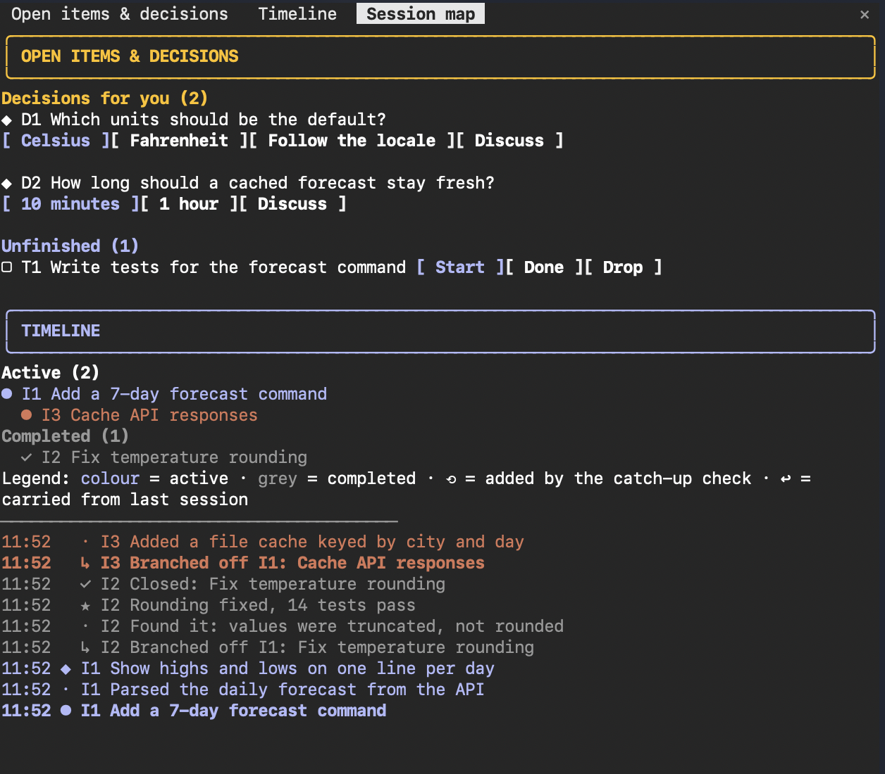

# session-map

A Claude Code mod that keeps you oriented in long sessions. One pane beside the chat shows what you're working on, what's been decided, and what's still waiting on you.



> **Early access.** Claude Code's mod API is still in early access and changes between Claude Code releases. A new Claude Code version can stop this mod from loading until it is updated. If the pane doesn't appear, open an issue and include your Claude Code version (`claude --version`).

## What it shows

- **Open items & decisions, at the top.** Decisions waiting on you, each with one button per option plus a **Discuss** button. Unfinished work, with **Start**, **Done** and **Drop** buttons. Clicking a button sends your choice straight to Claude as a message.
- **The timeline, below.** A history of the session's issues, newest at the top. Each issue has its own colour, and an issue that branched off another is indented under it. Closed issues fade to grey and are also listed under **Completed**. A legend line explains the colours.

Claude fills the pane in as it works, using three tools the mod adds (`timeline`, `open_items`, `session_map`) and a short instruction added to its system prompt. Every 10 turns, a cheap background check reads back over the conversation and adds anything Claude forgot to log. Those entries are marked ⟲. If Claude does work without logging it, the mod reminds it on the next turn.

Each session's map is saved, so `--resume` brings it back. When you start a new session in the same folder, the mod offers to bring in the open items from the last one, and asks Claude to check each one against the actual state of the work. Times are shown in your local time.

| Command | What it does |
|---|---|
| `/session-map` | Show or hide the combined pane (it opens on its own when a session starts) |
| `/timeline` | Show or hide the timeline on its own |
| `/open-items` | Show or hide the open items on its own |
| `/session-map-check` | Run the background catch-up check now |
| `/session-map-about` | Why the mod exists, what it does and how it works (also shown once, the first time it runs) |

Claude Code shows one pane at a time, and any other open pane becomes a tab. The pane docks beside the chat when the terminal is wide enough (roughly 110 to 144 columns).

## Install

At the prompt of a Claude Code session in a terminal:

```
/plugin install session-map --marketplace peacemakerxx99/session-map
```

From a shell:

```
claude plugin install session-map --marketplace peacemakerxx99/session-map
```

Answer `y` to add the marketplace, then pick a scope (user scope is listed first, so Enter selects it). In the desktop app, where `/plugin` doesn't run: click **+** next to the prompt box, then **Plugins**, **Add marketplace** with `peacemakerxx99/session-map`, then **Add plugin**.

**After installing, start a new session.** The session you install from gets the mod's tools and pane, but not the instruction that tells Claude to use them, so its timeline stays empty.

To get new versions automatically, open `/plugin`, go to **Marketplaces**, select `session-map` and choose **Enable auto-update**.

## Developing

```
claude plugin validate session-map   # what the engine would load or refuse
claude plugin test session-map       # runs session-map/hooks/*.test.tsx
claude --plugin-dir session-map      # a session with your working copy loaded
```

If you already have the mod installed, disable it first (`claude plugin disable session-map@session-map`). Otherwise `--plugin-dir` loads the installed copy instead of your working copy.

The types the engine writes into `session-map/.claude-plugin/types/` are the reference for the mod API.

## License

MIT
